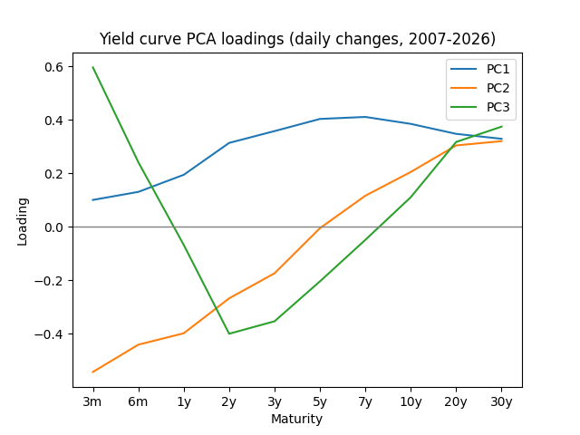

# Yield-curve PCA: three factors explain 95.5% of daily moves

Principal component analysis of daily changes in US Treasury yields, 10 maturities from 3 months to 30 years, 2007–2026. Three factors, level, slope and curvature, explain 95.5% of the daily moves of the curve.

Written for the course Asset Allocation and Investment Strategies (MSc Quantitative Finance, University of Warsaw), October 2026. This is my own part of a team homework.



## Data and method

- Source: FRED (Federal Reserve Economic Data, St. Louis Fed), daily constant-maturity US Treasury yields: DGS3MO, DGS6MO, DGS1, DGS2, DGS3, DGS5, DGS7, DGS10, DGS20, DGS30 (3 months to 30 years). The script downloads them from `https://fred.stlouisfed.org/graph/fredgraph.csv?id=DGS3MO,DGS6MO,DGS1,DGS2,DGS3,DGS5,DGS7,DGS10,DGS20,DGS30`.
- Period: 2007-01-03 to 2026-10-22, 4,955 daily changes.
- Days with a missing yield for any maturity (e.g. holidays) were removed. For each maturity, the daily change (today's yield minus the previous trading day's) was computed and converted to basis points (1 bp = 0.01 percentage point).

**Why daily changes, not yield levels:** the question is how the curve moves from one day to the next. Yield levels are dominated by a slow trend over many years (the 10-year yield was about 4.7% in 2007, 0.6% in 2020 and 4.5% in 2023), so PCA on levels would mostly pick up that trend instead of the daily movements.

**What PCA does here:** the input is a table with one row per day and one column per maturity, holding the daily changes. PCA finds the typical patterns of how the whole curve moves, ordered from the pattern that explains the most movement to the one that explains the least. Each pattern is described by its loadings: one number per maturity that says how strongly that maturity moves in the pattern. Every day's move of the curve is a mix of these patterns.

PC2 was multiplied by -1 so that a positive PC2 move means the curve gets steeper. PC1 and PC3 were left as computed.

## Results

**Explained variance (%)**

|     | share | cumulative |
|:----|------:|-----------:|
| PC1 |  75.4 |       75.4 |
| PC2 |  13.8 |       89.2 |
| PC3 |   6.3 |       95.5 |

- **PC1, level (75.4%):** all loadings are positive (0.10 at 3m up to 0.41 at 7y), so all yields move in the same direction: the whole curve shifts up or down.
- **PC2, slope (13.8%):** loadings are negative at the short end (-0.54 at 3m), cross zero around 5 years and are positive at the long end (+0.32 at 30y). A positive PC2 move means long yields rise relative to short ones (steepening); a negative one means flattening.
- **PC3, curvature (6.3%):** loadings are positive at both ends (+0.60 at 3m, +0.37 at 30y) and negative in the middle (-0.40 at 2y, -0.35 at 3y). The belly of the curve moves against the short and long ends.

These numbers are for data downloaded on 22 Oct 2026. The script always downloads the latest data, so a later run includes more days and can differ slightly.

## How to run

```bash
git clone https://github.com/konradaugustyn/yield-curve-pca.git
cd yield-curve-pca
pip install -r requirements.txt
python yield_curve_pca.py
```

It prints the number of days, the first and last date and the explained-variance table, and saves `explained_variance.csv` and `loading.png`.

## Limitations and next steps

- The loadings are estimated once on the whole sample, so they assume the patterns did not change over 2007–2026. Next step: a rolling-window PCA to see how stable they are.
- Constant-maturity yields from FRED, not traded bond prices.